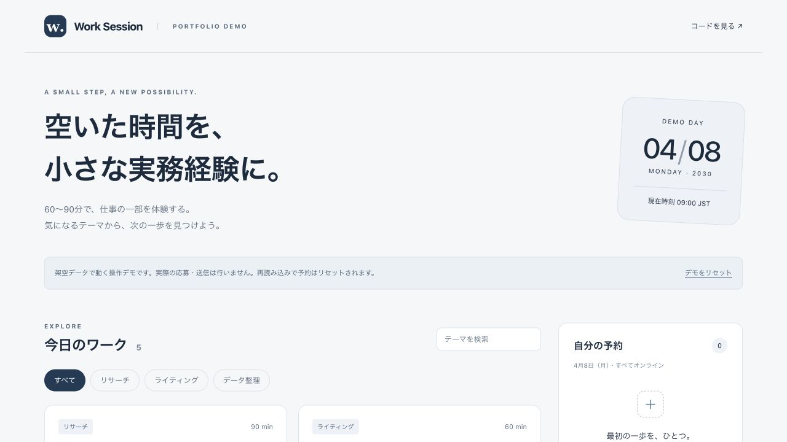

# Work Session

**空いた時間を、小さな実務経験に。**

架空の短時間ワークを探して予約・キャンセルできる、プロダクトエンジニア向けのポートフォリオサンプルです。
「操作しやすい画面」と「予約できる条件」を別々に設計し、なぜ予約できないかまで利用者に伝えます。



> **公開用に新規作成したデモです。** N限の本番コードを移植したものではありません。全データは架空で、実際の応募・メール送信・外部API接続は行いません。開発には生成AIを活用しています。

## まず見る場所

| 知りたいこと           | 読む場所                                         |
| ---------------------- | ------------------------------------------------ |
| どんな経験をしてきたか | [N限のケーススタディ](docs/ngen-case-study.md)   |
| なぜこの設計か         | [設計とトレードオフ](docs/architecture.md)       |
| 業務ルールの実装       | [booking.ts](src/domain/booking.ts)              |
| 境界条件の確認         | [booking.test.ts](src/domain/booking.test.ts)    |
| 画面から処理への接続   | [demoReducer.ts](src/application/demoReducer.ts) |

## 動かす

Node.js **22.12以上**とnpmが必要です。APIキーやDBは不要です。

```sh
npm ci
npm run dev
```

端末に表示されたローカルURLを開いてください。

```sh
npm run check  # テスト → TypeScript検査 → production build
```

## 試せること

1. テーマ検索・カテゴリ絞り込みでワークを探す。
2. 「街のカフェをリサーチする」を予約する。残り枠と自分の予約が更新される。
3. 時間が重なる「商品の魅力を言葉にする」が予約できなくなる。
4. 予約をキャンセルすると、空き枠と重複制限が元に戻る。
5. 満席・締切済みのワークは、理由が表示されて予約できない。
6. 「デモをリセット」で初期状態へ戻す。

デモの時計は **2030年4月8日 09:00（日本時間）** に固定しています。再読み込みでも初期状態に戻ります。

## 仕様

- 予約枠を消費するのは `confirmed` の予約だけ。
- 同じ利用者・同じワークの重複予約は不可。
- 時間帯は `[開始, 終了)` として扱い、終了直後に始まるワークは予約可能。
- 締切時刻ちょうどから予約不可。開始時刻ちょうどからキャンセル不可。
- キャンセルは予約本人のみ。キャンセル済みの記録は履歴として保持する。
- 予約可否の表示と実際の予約処理が、同じドメイン関数を使う。

## 技術

React / TypeScript（strict）/ Vite / CSS Modules / Vitest / GitHub Actions

## このデモの範囲

ブラウザ内の単一利用者向けサンプルです。認証・永続化・決済・複数利用者の同時予約は実装していません。予約の所有者チェックは業務ルールの例であり、クライアント側だけで安全な認可を実現するものではありません。

本番化では、サーバー上の認証・認可、DBトランザクションによる定員保護、重複防止制約、監査ログなどが必要です。[詳細な設計判断](docs/architecture.md)にまとめています。

## 開発について

N限で扱ってきた「学生が短時間の仕事を探して参加する」という課題を題材に、公開用に範囲を絞って新規作成しました。AI支援を使用しており、このリポジトリのコードを過去の本番実装や単独で手書きした成果とは位置付けていません。
