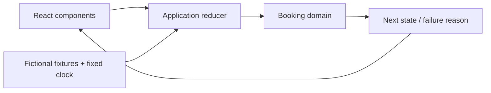

# 設計とトレードオフ

## 目的

短時間ワークを選ぶ利用者に、「予約できるか」「いつ参加するか」「何を持ち帰れるか」を伝える。
公開サンプルとして、業務ルールと画面のつながりを短い時間でレビューできることを優先する。

## 責務の分離

| 層                           | 役割                                     | 依存させないもの                            |
| ---------------------------- | ---------------------------------------- | ------------------------------------------- |
| `components/` / `App.tsx`    | 表示、検索、利用者の操作                 | DB、独自の予約判定                          |
| `application/demoReducer.ts` | 操作をドメインに渡し、結果を画面用に変換 | DOM操作                                     |
| `domain/booking.ts`          | 定員・締切・重複・キャンセルのルール     | React、通信、ストレージ、現在時刻の直接取得 |
| `data/demo.ts`               | 架空のワークと初期状態、固定時計         | 本番データ、認証情報                        |

古典的なMVCの命名には合わせず、Reactの描画モデルに合わせて責務を分けた。Viewに相当する部分はReact、業務ルールは純粋関数、操作の調整はreducerが担う。実データの永続化を持たないため、DBのModel層やRepositoryを形だけ追加していない。

## 主な判断

### 1. 判定と更新でルールを共有する

`bookingAvailability` は画面のボタン表示にも、`bookSession` 内の最終判定にも使用する。
画面で無効化するだけに依存せず、処理の入口でもチェックする。理由は識別子で返し、画面用の日本語文言はapplication層に集約した。

### 2. 時刻を引数で受け取る

`Date.now()` を業務処理の中で呼ばない。締切の直前・ちょうど・開始後を決定的にテストできる。
表示は `Asia/Tokyo` に固定し、閲覧者のタイムゾーンで時刻が変わらないようにした。
デモの固定日時や架空の定員は、意図したfixtureとして一か所に置く。

### 3. 状態は破壊せず、新しい状態を返す

失敗時は元の状態を返す。キャンセルは削除ではなく状態遷移として扱い、再予約には新しいIDを使う。
Reactのreducerでローカル操作を順番に処理するため、連打でも一つ前の更新を踏まえて判定する。
これは複数ブラウザ間の排他制御ではない。

### 4. 体験を確認しやすい範囲にする

APIキーやDBの準備なしで動かせるよう、状態はメモリ内に限定した。
代わりに、リロード時に消えることを画面にも記載した。localStorageに実在の利用者情報を保存する設計にはしていない。

### 5. テストは境界条件に重点を置く

定員の最後の1枠、二重送信、締切ちょうど、時間帯の隣接・重複、他人の予約のキャンセル、再予約を確認する。
TypeScriptのstrict検査はビルド前に必須とし、型エラーを無視してビルドする設定は設けない。

## 本番に拡張するなら

| 課題             | 次の実装                                                                         |
| ---------------- | -------------------------------------------------------------------------------- |
| 認証・認可       | サーバーセッションから本人IDを取得し、クライアントの申告を信用しない             |
| 同時予約         | 予約確認と確定を同一DBトランザクション内で実行。定員の行ロック等で超過を防ぐ     |
| 同じ人の同時操作 | 有効予約の一意制約や冪等性キーを設ける。時間重複も利用者単位の排他制御で検証する |
| 返却データ       | 公開用DTOへ射影し、利用者・企業の全レコードをそのまま返さない                    |
| 永続化           | Repositoryの境界を設け、DB実装とテスト用実装を切り替える                         |
| 通知             | 予約確定後の耐久ジョブに分離し、送信失敗で予約結果を曖昧にしない                 |
| 観測             | 予約試行・成功・拒否理由・キャンセルを計測する。個人情報をログへ出さない         |

## 次の検証

- 小さな画面やキーボード操作で、予約後の状態変化に気づけるか。
- 残り枠よりも成果物の説明を優先したとき、利用者が仕事を選びやすくなるか。
- 時間重複の理由を表示すると、予約済み予定への理解が進むか。

改善効果の数値はまだ測定していない。仕様の説明と効果の実証は区別する。
